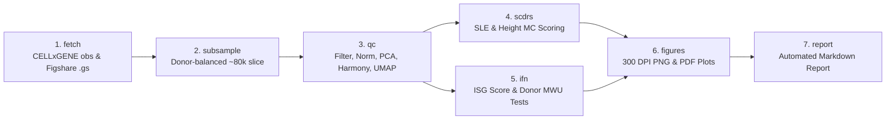

# Lupus Cell States to Drugs (`lupus_p1`)

[](https://www.python.org/downloads/release/python-3120/)
[](#)
[](https://cellxgene.cziscience.com/collections/436154da-bcf1-4130-9c8b-120ff9a888f2)

A reproducible, memory-bounded single-cell computational pipeline linking **Systemic Lupus Erythematosus (SLE)** polygenic GWAS risk (`scDRS`) and **type-I interferon (IFN)** transcriptional signatures to pathogenic PBMC cell states in the Perez et al. 2022 cohort (~1.2M cells), establishing a genetics-anchored foundation for downstream candidate drug repurposing.

---

## Table of Contents

- [Overview & Scientific Objectives](#overview--scientific-objectives)
- [Pipeline Architecture](#pipeline-architecture)
- [Repository Structure](#repository-structure)
- [Data Sources & Accessions](#data-sources--accessions)
- [Compute Requirements & Memory Strategy](#compute-requirements--memory-strategy)
- [Quick Start & Usage](#quick-start--usage)
- [Output Inventory](#output-inventory)
- [Interpreting `scDRS` Outputs](#interpreting-scdrs-outputs)
- [Known Limitations](#known-limitations)
- [Verification Checklist (`TODO(verify)`)](#verification-checklist-todoverify)

---

## Overview & Scientific Objectives

Systemic lupus erythematosus (SLE) is a chronic autoimmune disease characterized by a prominent type-I interferon (IFN) transcriptional signature in peripheral blood mononuclear cells (PBMCs) and dysregulation across multiple lymphoid and myeloid compartments. **Phase 1** of this project builds a rigorous, memory-bounded computational foundation to connect genetics-anchored disease cell states to candidate therapeutics in subsequent phases.

Phase 1 executes three core objectives without making causal or drug-efficacy claims:

1. **Dataset Acquisition, Metadata Summary, Subsampling, and QC**:
   - Dynamically resolve and retrieve the Perez et al. 2022 (*Science*, `doi:10.1126/science.abf1970`) scRNA-seq PBMC dataset from CZ CELLxGENE Discover (`436154da-bcf1-4130-9c8b-120ff9a888f2`).
   - Summarize full-dataset donor and cell metadata (~1.2M cells) without loading the full expression matrix into RAM.
   - Construct a deterministic, donor-balanced, cell-type-floored subsample (60,000–100,000 cells; default target 80,000).
   - Perform quality control, normalization, highly variable gene (HVG) selection, Harmony batch integration, and neighborhood graph construction while preserving author cell-type annotations.
2. **Polygenic Disease Enrichment Scoring (`scDRS`)**:
   - Score every subsampled cell for SLE polygenic GWAS enrichment using single-cell Disease Relevance Score (`scDRS`; Zhang et al. 2022, *Nature Genetics*, `doi:10.1038/s41588-022-01167-z`) alongside **height** as a negative-control trait.
   - Aggregate single-cell scores across author cell types using `scDRS` downstream Monte Carlo tests for cell-type-level association (`assoc_mcp`, `assoc_mcz`), within-cell-type spatial heterogeneity (`hetero_mcp`, `hetero_mcz`), and FDR-thresholded cell fractions (`frac_fdr_0.1`).
3. **Interferon Known-Answer Validation**:
   - Compute a 22-gene IFN-stimulated gene (ISG) module score per cell (`IFI27`, `IFI44`, `IFI44L`, `IFIT1`, `IFIT3`, `ISG15`, `MX1`, `OAS1`, `STAT1`, `USP18`, etc.).
   - Evaluate SLE-versus-healthy differences strictly **at the donor level** within each cell type (and stratified by donor ancestry where sample sizes permit) via two-sided Mann-Whitney U tests with Benjamini-Hochberg (BH) multiple-testing correction and rank-biserial effect sizes.

### Prior Biological Expectations (Post-Execution Calibration)
Used strictly to evaluate calibration and biological plausibility after execution—never hard-coded or assumed by the pipeline:
- **SLE `scDRS` Enrichment**: Expected in immune compartments implicated in lupus pathogenesis (B cells/plasmablasts, monocytes, dendritic cells, or T/NK subsets).
- **Height Negative Control**: Should show no statistically significant cell-type association in PBMCs; any significant association ($\text{BH } q < 0.05$) triggers an automated calibration warning.
- **ISG Module Score**: Expected to be elevated in SLE donors relative to healthy controls, particularly in myeloid/monocyte populations.

---

## Pipeline Architecture



---

## Repository Structure

```text
├── config.yaml                  # Central pipeline configuration (seeds, thresholds, gene lists)
├── Makefile                     # Convenience targets (setup, test, fetch, subsample, qc, scdrs, ifn, figures, report, all)
├── requirements.txt             # Pinned Python 3.12 dependencies
├── run_phase1.py                # CLI entry point with step orchestration, dry-run, and RSS tracking
├── src/
│   └── lupus_p1/
│       ├── __init__.py
│       ├── config.py            # Dataclass configuration loader and validator
│       ├── download.py          # CELLxGENE Curation API, Census/H5AD fetch, and Figshare .gs downloader
│       ├── subsample.py         # Deterministic donor-balanced & cell-type-floored subsampling
│       ├── qc_preprocess.py     # Scanpy QC filtering, normalization, HVG, PCA, Harmony, kNN, UMAP
│       ├── scdrs_scoring.py     # Sequential per-trait scDRS scoring & group-level Monte Carlo analysis
│       ├── ifn_check.py         # ISG module scoring & donor-level Mann-Whitney U testing
│       ├── plotting.py          # Publication-grade figures (PNG + PDF)
│       ├── report.py            # Automated data-driven Phase 1 report generator
│       ├── provenance.py        # SHA256/MD5 checksum verification & provenance JSON logging
│       └── logging_utils.py     # Structured logging & peak memory (RSS) profiling
└── tests/                       # Offline pytest suite running on synthetic AnnData fixtures
    ├── conftest.py
    ├── test_config.py
    ├── test_ifn_check.py
    ├── test_provenance.py
    ├── test_scdrs_traits.py
    └── test_subsample.py
```

---

## Data Sources & Accessions

| Resource | Identifier / Endpoint | Role in Phase 1 | License / Terms |
| :--- | :--- | :--- | :--- |
| **Perez et al. 2022 SLE PBMC scRNA-seq** | CZ CELLxGENE Discover Collection: [`436154da-bcf1-4130-9c8b-120ff9a888f2`](https://cellxgene.cziscience.com/collections/436154da-bcf1-4130-9c8b-120ff9a888f2) | Primary single-cell expression and donor/cell metadata source. Dataset ID(s) inside the collection are resolved dynamically at runtime via the CELLxGENE Curation REST API. | CZ CELLxGENE Discover terms (CC-BY 4.0). |
| **Perez et al. 2022 Archival Accession** | NCBI GEO: `GSE174188` | Recorded in `outputs/provenance/provenance.json` for archival cross-reference. | NCBI GEO terms of use. |
| **CZ CELLxGENE Census** | Python package `cellxgene-census`, pinned build `"2025-11-08"` (LTS) | Default metadata-first query and slice retrieval backend (`is_primary_data == True`). | CZI Census terms of service. |
| **scDRS MAGMA GWAS Gene Sets (74 traits)** | Figshare Article [`19312583`](https://figshare.com/articles/dataset/scDRS_data_release_030122/19312583) | Polygenic GWAS gene sets and weights (`.gs` format) for SLE and height negative control. Verified by MD5/SHA256 upon download. | Academic open-access release accompanying Zhang et al. 2022 (*Nat Genet*). |
| **Kang et al. 2018 IFN-$\beta$ PBMC (Optional)** | NCBI GEO: `GSE96583` | Optional external positive control for the ISG module score (`ifn_external_control.enabled: false` by default). | NCBI GEO terms of use. |

---

## Compute Requirements & Memory Strategy

### Target Hardware Envelope
- **CPU**: 8 cores (`n_jobs: 8` configurable in `config.yaml`)
- **Memory**: ~5 GB free RAM (no swap assumed)
- **GPU**: None required
- **Disk**: ~100 GB free disk space (for H5AD cache, SOMA tile cache, intermediate scores, and outputs)

### Memory-Bounded Strategy
The full Perez et al. 2022 dataset contains ~1.2 million cells and **is never loaded in full into memory**:
1. **Metadata-First Discovery (`fetch` & `subsample`)**:
   - **`census` backend (default)**: Queries only the `obs` table via `cellxgene_census.get_obs()`. The subsampling algorithm runs purely on this `pandas.DataFrame` (~1.2M rows uses <300 MB RAM). Only the selected ~80,000 cell coordinates (`soma_joinid`) are passed to `cellxgene_census.get_anndata()` to fetch raw counts.
   - **`h5ad` backend**: Downloads the source `.h5ad` file to `data_cache/`, opens it on disk with `anndata.read_h5ad(..., backed="r")`, extracts `.obs` into memory to select the subsample indices, and materializes only the selected slice (`adata[selected_idx].to_memory()`).
2. **Sequential Per-Trait Scoring (`scdrs`)**:
   - `scDRS` generates `n_ctrl` (default 1,000) Monte Carlo control scores per cell. Scoring traits sequentially (one trait at a time), writing `outputs/data/scdrs/<trait>.full_score.gz` and `.parquet` immediately to disk, and explicitly freeing full-score matrices (`del` + `gc.collect()`) keeps peak RSS within the ~5 GB budget.
3. **Stepwise Checkpointing & Peak RSS Logging**:
   - Every pipeline step reads its inputs from disk and writes outputs to `outputs/`, allowing single-step execution and automatic skipping of completed steps unless `--force` is passed. Peak resident set size (RSS) is logged at the start and end of every step.

---

## Quick Start & Usage

### 1. Environment Setup (`uv`)
Python **3.12** is required (`scanpy >= 1.12` requires Python $\ge 3.12$). All package dependencies in `requirements.txt` are pinned with exact `==` specifiers.

```bash
# Create a Python 3.12 virtual environment using uv
uv venv --python 3.12 .venv

# Activate the virtual environment (Linux/macOS)
source .venv/bin/activate
# Or on Windows PowerShell:
# .venv\Scripts\Activate.ps1

# Install pinned dependencies
uv pip install -r requirements.txt
```
*(Or simply run `make setup` on Linux/macOS).*

### 2. Running the Pipeline

Run the entire Phase 1 workflow end-to-end:
```bash
make all
# Equivalent to:
python run_phase1.py --step all --config config.yaml
```

Run individual steps (each step checks for existing outputs and skips unless `--force` is supplied):
```bash
python run_phase1.py --step fetch --config config.yaml
python run_phase1.py --step subsample --config config.yaml
python run_phase1.py --step qc --config config.yaml
python run_phase1.py --step scdrs --config config.yaml
python run_phase1.py --step ifn --config config.yaml
python run_phase1.py --step figures --config config.yaml
python run_phase1.py --step report --config config.yaml
```

Validate configuration and planned execution in dry-run mode (no network or heavy compute):
```bash
python run_phase1.py --step all --config config.yaml --dry-run
```

### 3. Running the Test Suite
Run the offline unit test suite (executes in <1 minute on synthetic fixtures):
```bash
make test
# Equivalent to:
pytest -q
```

### Estimated Runtime Ranges (8 CPU Cores, ~5 GB RAM, Linux)
- **`fetch`**: ~3–15 min (Census `obs` fetch + Figshare `.gs` download; ~15–40 min if downloading full source `.h5ad`).
- **`subsample`**: ~1–3 min (in-memory `obs` stratification + slicing ~80,000 cells).
- **`qc`**: ~5–12 min (QC metrics, normalization, HVG selection, 50-PC PCA, Harmony integration, kNN graph, and UMAP).
- **`scdrs`**: ~15–35 min (~7–15 min per trait for `n_ctrl=1000` on ~80,000 cells, plus kNN downstream group analysis).
- **`ifn`**: ~1–2 min (`score_genes` + donor-level aggregation and Mann-Whitney U tests).
- **`figures` & `report`**: ~1–3 min.

---

## Output Inventory

All outputs are written relative to `outputs_dir` (default `outputs/`):

- **Provenance (`outputs/provenance/`)**:
  - `provenance.json`: Structured JSON records for every remote resource accessed (URLs, resolved dataset IDs, Census versions, package versions, ISO-8601 timestamps, byte sizes, and MD5/SHA256 digests).
  - `checksums_outputs.txt`: SHA256 digests of every file produced in `outputs/`.
- **Logs (`outputs/logs/`)**:
  - `run_<timestamp>.log`: Detailed timestamped execution log including step durations, package versions, git commit hash, and peak RAM usage per step.
  - `config_used_<timestamp>.yaml`: Exact snapshot of the configuration used for the run.
- **Processed Data (`outputs/data/`)**:
  - `obs_full_metadata.parquet`: Full-dataset cell metadata (`obs`) fetched during `fetch`.
  - `subsample_selected_obs.parquet`: Metadata table for the selected subsample cells.
  - `sle_pbmc_subsample_raw.h5ad`: Raw-count AnnData for the subsampled cells prior to QC filtering.
  - `sle_pbmc_subsample_processed.h5ad`: QC-filtered, normalized, HVG-annotated, PCA/Harmony/kNN/UMAP-processed AnnData with raw counts preserved in `adata.layers["counts"]`, per-cell `scDRS` scores, and `isg_score` in `adata.obs`.
  - `scdrs/<trait>.full_score.gz` & `scdrs/<trait>.score.parquet`: Per-cell `scDRS` normalized scores, raw scores, z-scores, Monte Carlo p-values, and cell-level FDRs.
- **Tables (`outputs/tables/`)**:
  - `metadata_summary_*.csv`: Full-dataset donor and cell count summaries by disease, ancestry, sex, batch, and medication columns.
  - `subsample_counts.csv`: Cell and donor counts before vs. after subsampling.
  - `qc_filter_summary.csv`: Cells and genes retained and removed at each QC step.
  - `scdrs_celltype_<trait>.csv` & `scdrs_celltype_combined.csv`: Per-cell-type `scDRS` downstream summary (`n_cell`, `assoc_mcp`, `assoc_mcz`, `hetero_mcp`, `hetero_mcz`, `n_fdr_0.1`, `frac_fdr_0.1`, and BH-adjusted `assoc_mcp_bh`).
  - `ifn_donor_means.csv` & `ifn_donor_level_stats.csv`: Donor-level ISG means and Mann-Whitney U test statistics (overall and ancestry-stratified), medians, rank-biserial correlations, and BH-adjusted p-values.
- **Figures (`outputs/figures/`, saved as both 300 DPI `.png` and vector `.pdf`)**:
  - `qc_violin`: Per-cell distributions of `n_genes_by_counts`, `total_counts`, and `pct_counts_mt`.
  - `subsample_composition`: Bar charts comparing cell-type and disease proportions before vs. after subsampling.
  - `umap_celltype`, `umap_disease`, `umap_ancestry`, `umap_batch`: UMAP embeddings colored by metadata covariates.
  - `scdrs_umap_<trait>` & `scdrs_celltype_<trait>`: Per-cell UMAPs and cell-type $-\log_{10}(\text{assoc MC } p)$ bar plots.
  - `scdrs_sle_vs_height`: Side-by-side comparison of cell-type enrichment between SLE and height negative control.
  - `ifn_isg_by_celltype_disease` & `umap_isg_score`: Donor-level box/strip plots of mean ISG scores and single-cell ISG UMAP.
- **Report (`outputs/reports/`)**:
  - `phase1_run_report.md`: Automatically generated markdown report populated strictly from computed tables, provenance metadata, calibration checks, caveats, and Phase 2 roadmap.

---

## Interpreting `scDRS` Outputs

`scDRS` (Zhang et al. 2022) evaluates polygenic disease enrichment at single-cell and cell-type resolution:
1. **Cell-Level Scores**: Computes a raw disease score from the MAGMA top-1,000 GWAS genes weighted by GWAS z-scores and inverse expression technical noise (`weight_opt="vs"`), alongside `n_ctrl` (default 1,000) Monte Carlo control gene sets matched on expression mean and variance bins (`n_mean_bin=20, n_var_bin=20`).
2. **Group-Level Association (`assoc_mcp`, `assoc_mcz`)**: Tests whether the mean normalized score in a given cell type is significantly higher than expected under the Monte Carlo control distribution across cells in that group.
3. **Within-Group Heterogeneity (`hetero_mcp`, `hetero_mcz`)**: Uses Geary's $C$ along the cell-cell kNN graph (`obsp["connectivities"]`) within a given cell type to test whether cells with high disease scores cluster spatially in state space (indicating a disease-associated sub-state).
4. **Monte Carlo P-Value Floor**: Empirical Monte Carlo p-values (`assoc_mcp`, `hetero_mcp`) are bounded below by $\frac{1}{1 + n_{\text{ctrl}}}$ ($p \ge 9.99 \times 10^{-4}$ when `n_ctrl: 1000`). Use `assoc_mcz` and `hetero_mcz` (Monte Carlo z-scores) to rank cell types that reach the empirical p-value floor.
5. **FDR Cell Fraction (`n_fdr_0.1`, `frac_fdr_0.1`)**: Proportion of individual cells within a cell type whose cell-level Monte Carlo p-value passes Benjamini-Hochberg $\text{FDR} < 0.1$ across all cells.

---

## Known Limitations

1. **Subsampling Variance**: To operate within ~5 GB RAM, the pipeline analyzes a donor-balanced, cell-type-floored subsample of ~80,000 cells out of ~1.2M total cells. Stability across multiple seeds can be evaluated via `subsample.seeds_for_stability` in `config.yaml`.
2. **Census vs. Source H5AD Metadata Columns**: The `census` backend provides standardized CZ CELLxGENE schema columns (`donor_id`, `disease`, `cell_type`, `self_reported_ethnicity`, `sex`, `assay`), which may omit study-specific author columns such as processing batch or finest-grain subcluster labels. Switching `cellxgene.backend: "h5ad"` preserves all original author `.obs` columns.
3. **GWAS Ancestry Mismatch**: The `scDRS` 74-trait MAGMA gene sets (release `030122`) were derived predominantly from European-ancestry GWAS cohorts, whereas the Perez et al. 2022 cohort includes donors of diverse ancestry (European and East Asian). Cross-ancestry LD differences may attenuate polygenic signal for ancestry-specific risk variants.
4. **Medication and Clinical Confounding**: SLE donors frequently receive immunomodulatory therapies (e.g., hydroxychloroquine, corticosteroids, mycophenolate) and vary in disease activity (SLEDAI). Any treatment metadata present in `.obs` are inventoried in Step A, but unrecorded medication differences can influence transcriptional states such as the IFN signature.

---

## Verification Checklist (`TODO(verify)`)

Assumptions regarding external API response fields, third-party function signatures, or column names are annotated in the source code with `# TODO(verify):` and validated at runtime:
1. **`requirements.txt`**: Confirm exact dependency resolution on target host with `uv pip compile requirements.txt`.
2. **`src/lupus_p1/download.py` (CELLxGENE Curation API)**: Confirm JSON field names returned by `GET /curation/v1/collections/{collection_id}` (`datasets`, `dataset_id` vs `id`, `title`, `cell_count`).
3. **`src/lupus_p1/download.py` (Census `get_obs` / `get_anndata`)**: Confirm parameter names against `cellxgene-census==1.16.2` (`obs_value_filter`, `obs_coords`, `column_names`, `X_name="raw"`).
4. **`src/lupus_p1/download.py` (Census `download_source_h5ad`)**: Confirm signature of `cellxgene_census.download_source_h5ad`.
5. **`src/lupus_p1/download.py` (Figshare API `19312583`)**: Confirm `.gs` filename and JSON keys (`files`, `name`, `download_url`, `supplied_md5`, `computed_md5`).
6. **`src/lupus_p1/download.py` (Optional `GSE96583` Control)**: Confirm supplementary file names and matrix layout on GEO if enabling `ifn_external_control.enabled: true`.
7. **`src/lupus_p1/qc_preprocess.py` (Gene Symbol Mapping)**: Confirm `var` column holding HGNC gene symbols (`feature_name` vs `gene_symbols` vs `var_names`).
8. **`src/lupus_p1/qc_preprocess.py` (Harmony Integration)**: Confirm `harmonypy.run_harmony` return attribute (`.Z_corr`) and matrix orientation in `harmonypy==0.0.10`.
9. **`src/lupus_p1/scdrs_scoring.py` (`scDRS` API)**: Confirm signatures and return columns of `scdrs.util.load_gs`, `scdrs.preprocess`, `scdrs.score_cell`, and `scdrs.method.downstream_group_analysis` in `scdrs==1.0.2`.
